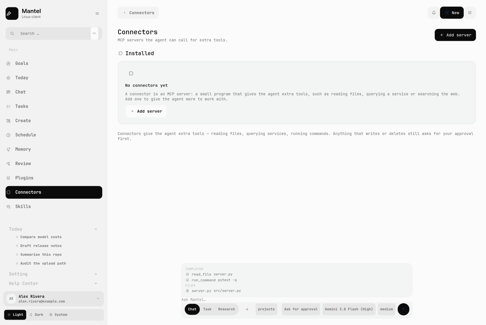

# Gemini Desktop for Linux

A native GTK4 desktop client for Gemini — no Electron, no web wrapper, no
Wine. It was built by reverse-engineering the official desktop application:
the intelligence is that application's own engine, driven over its JSON
streams, wrapped in a Linux shell that follows a design I liked.


> **Unofficial.** Not affiliated with, endorsed by, or supported by Google.
> This repository contains no Google code, fonts, images or protocol
> descriptors — see [Third-party material](#third-party-material).

## Why this exists

There is no official Gemini desktop build for Linux. Running the Windows
build under Wine is miserable, and an Electron shim would just be the website
in a frame. So the interesting question was: what actually *is* the desktop
app, and can its brain be driven from a real native client?

It can. The app ships a Go engine that speaks a documented JSON stream
protocol, keeps its own permission model in a config file, and holds the
conversation. That engine does the thinking; this repository is the client
that makes it usable — a GTK4/libadwaita shell with the account, approvals,
history, tools and surfaces a desktop agent needs.

## What it does

**It behaves like an agent, not a chat box**

- Three modes: **Chat**, **Task** (the agentic surface) and **Research**
  (task mode plus a sourcing brief).
- A **work panel** above the prompt showing what the agent completed, what it
  is doing, what it plans and which files it touched.
- **Approval ladder** in the vocabulary Codex and Claude desktop settled on —
  *allow once / allow for this session / always allow in this folder / deny* —
  backed by the engine's real permission rules, so a grant is a rule the
  engine honours rather than a flag this client pretends to keep.
- **Changes panel** that asks git what actually changed on disk, with a diff
  viewer. The working tree is the source of truth, not the agent's claims.

**It is a desktop application**

- Google account sign-in over OAuth, with the loopback redirect and CSRF
  check done properly; the account card shows identity and token state.
- **Scheduled** prompts on a five-field cron, run by an in-app timer.
- **Connectors** (MCP servers) and **Skills**, read from and written to the
  engine's own stores, so the CLI agrees with the UI.
- **Create**: image generation, with the results gallery.
- Screen capture attached to a prompt; remote control from a phone.
- Global-hotkey quick chat, desktop notifications, light/dark/system themes,
  session model and reasoning-effort pickers.

## Screenshots

| | |
|---|---|
|  |  |
|  |  |
|  |  |

Every image in `docs/screenshots/` is an offscreen render of the real widget
tree, produced by `tools/make_screenshots.py`. They use `--demo` data, so no
real account or path appears in them.

## How it works

```
┌───────────────────────────────┐        ┌──────────────────────────────┐
│  GTK4 + libadwaita client     │        │  the vendor's Go engine      │
│                               │        │                              │
│  window ─ composer ─ pages    │ spawn  │  --print                     │
│    │         │                │───────►│  --output-format stream-json │
│    │         └─ session ──────┼─ NDJSON│  --model / --mode / grants   │
│    │                          │◄───────│                              │
│  chat_view · work panel       │ events │  reads ~/.gemini for auth    │
│  approvals · changes          │        │  and the permission rules    │
└───────────────────────────────┘        └──────────────────────────────┘
```

The client never reimplements the model. It spawns the engine, parses
`init` / `step_update` / `result` events, renders the stream, and turns the
engine's refusals (`denied_actions`) into approval cards. Granting writes a
rule into the engine's permission config and replays the request.

- [`docs/ARCHITECTURE.md`](docs/ARCHITECTURE.md) — module map and the
  decisions behind it.
- [`docs/DESIGN.md`](docs/DESIGN.md) — the design system, measured.
- [`docs/reverse-engineering/`](docs/reverse-engineering/) — how the engine
  and its protocol were recovered, and the notes from the port itself.

## Requirements

- Linux with GTK4 and libadwaita
- Python 3.10+ (developed and tested on 3.14), PyGObject, Pycairo
- The Gemini CLI engine (`agy`) on `PATH`, signed in to a Google account.
  It is **not** distributed here; install it yourself.

```bash
# Debian/Ubuntu
sudo apt install python3-gi python3-gi-cairo gir1.2-gtk-4.0 gir1.2-adw-1 \
                 python3-cairo
# Fedora
sudo dnf install python3-gobject gtk4 libadwaita python3-cairo
```

## Run it

```bash
git clone https://github.com/<you>/gemini-desktop-linux && \
  cd gemini-desktop-linux
./packaging/install.sh       # launcher, desktop entry, no root needed
gemini-desktop
```

Or run in place without installing:

```bash
python3 -m app.main
```

**No account? Look at the UI anyway.** Demo mode fills the window with sample
content and never calls the engine or your real data:

```bash
python3 -m app.main --demo
```

Useful flags: `--workspace ~/code`, `--quick` (quick-chat overlay),
`--page chat`, `--scheme dark`, `--demo`.

To bind quick chat to a key:

| Compositor | Binding |
|---|---|
| GNOME | Settings → Keyboard → Custom Shortcuts → `gemini-desktop --quick` |
| Hyprland | `bind = SUPER, SPACE, exec, gemini-desktop --quick` |

### The pixel-accurate look is optional

The shell is designed around fonts and icon glyphs that belong to the
original application, so they are not in this repository. Without them the
client falls back to system fonts and stock symbolic icons and still lays out
correctly — that is what a fresh clone looks like. To get the look in the
screenshots, supply your own copies and rebuild the glyph atlas:
[`assets/README.md`](assets/README.md).

## Tests

```bash
python3 tests/test_schedules.py          # cron maths, store, pause/resume
python3 tests/test_changes.py            # the git reader, on a real repo
python3 tests/test_context_fallback.py   # replayed history when resume fails
python3 tests/test_extras.py             # parsers for remote/screenshot/create
python3 tests/test_signin.py             # OAuth against a mock Google, incl. CSRF
python3 tests/test_engine.py "Say OK"    # the live engine bridge
python3 tests/test_agent_flow.py         # refuse -> approve -> the file appears
python3 tests/test_scheduler_run.py      # a schedule fires a real agent turn
```

The three engine-backed tests need `agy` and an account and skip cleanly
without one. They were the point of the exercise: proving the approval loop
end to end against the real engine, not against a mock.

## Repository layout

```
app/                      the GTK4 client
  window.py               rail, page stack, work panel, approvals
  composer.py             mode / model / effort / workspace controls
  engine.py               the JSON-stream bridge
  session.py              modes, approval state, work items
  permissions.py          reads and writes the engine's grant config
  approval.py             approval cards
  changes.py              git-backed change list
  schedules.py            cron engine and store
  scheduler.py            the in-app runner
  pages/                  account, tasks, create, schedule, connectors,
                          skills, settings
assets/                   glyph name table (+ how to supply the real assets)
docs/                     architecture, design system, screenshots, RE notes
packaging/install.sh      per-user install
tests/                    test suite + the offscreen render harness
tools/                    asset pipeline, protocol probes, screenshot maker
```

## Limitations, honestly

- **Approvals replay rather than pause.** The engine's non-interactive stream
  accepts exactly one input event (`user`), so there is no message that
  answers a permission prompt mid-turn. Granting a rule and retrying costs a
  second turn. This is a measured property of the engine, documented in
  `docs/reverse-engineering/PORT_NOTES.md`.
- **Voice isn't here.** Gemini Live needs a first-party-authenticated bidi
  stream that this client cannot reach.
- **It depends on the engine.** If `agy` changes its stream format, the bridge
  needs updating; the parser is deliberately tolerant and pinned by tests.
- **Local schedules only run while the app is open** — the same contract
  Claude desktop uses for local tasks.
- The account flow signs in through the engine's own credentials. Using a
  consumer account outside the vendor's client is your call and may not be
  permitted by its terms.

## Third-party material

None is redistributed here. The client loads, at your option, typefaces and
icon glyphs extracted from the original application by the scripts in
`tools/`; those remain the property of their owners and are gitignored. The
Gemini name and marks belong to Google. The OAuth client used for sign-in is
Google's published open-source CLI client, not a secret of mine.

## Design credit

The interface follows the **"Hearth" concept dashboard by
[@UiRahMan92](https://x.com/UiRahMan92)**. The tribute is deliberate: the grid,
the rhythm and the muted palette are theirs; the measurements in
[`docs/DESIGN.md`](docs/DESIGN.md) are mine.

## Licence

MIT — see [LICENSE](LICENSE). That covers this repository's code and
documentation only.
