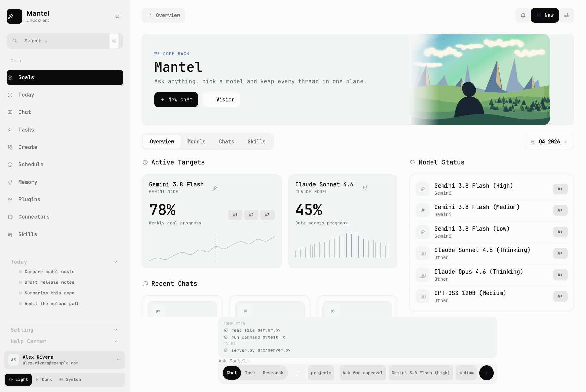
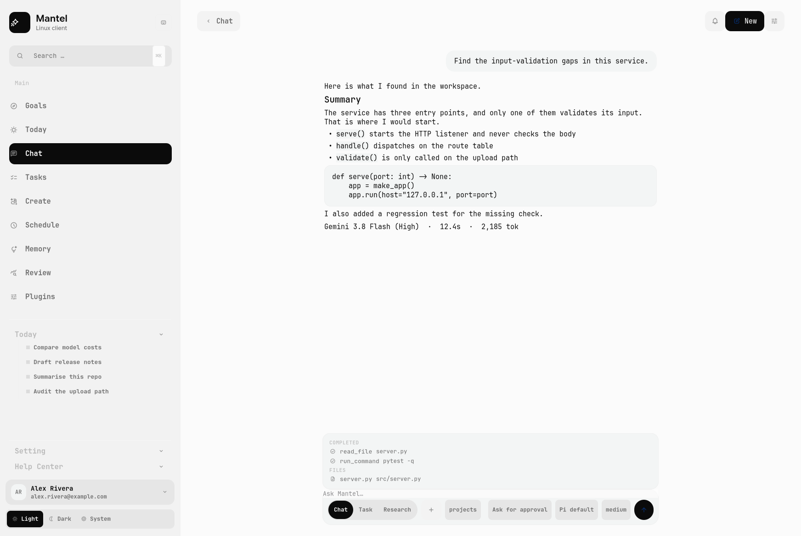
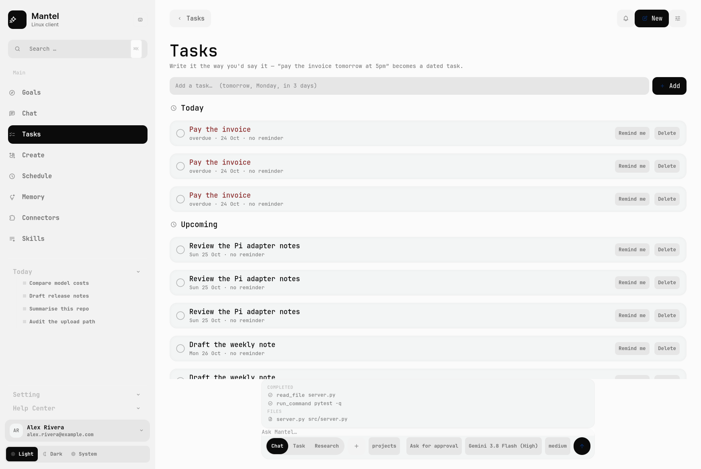
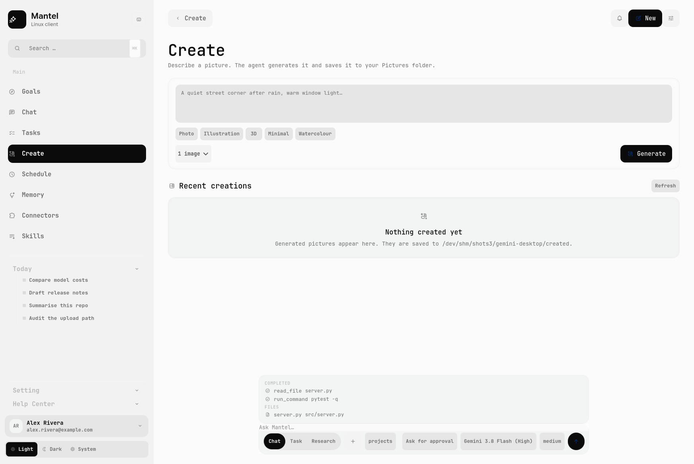
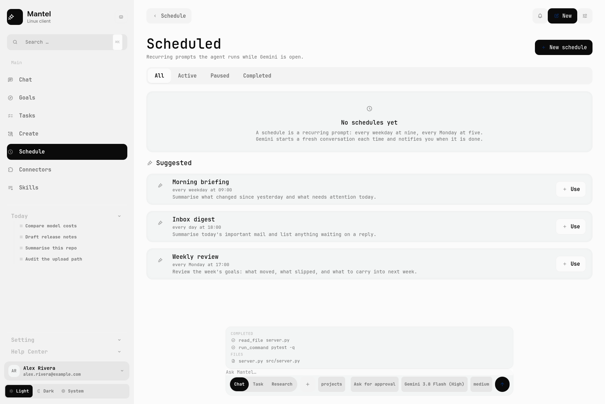
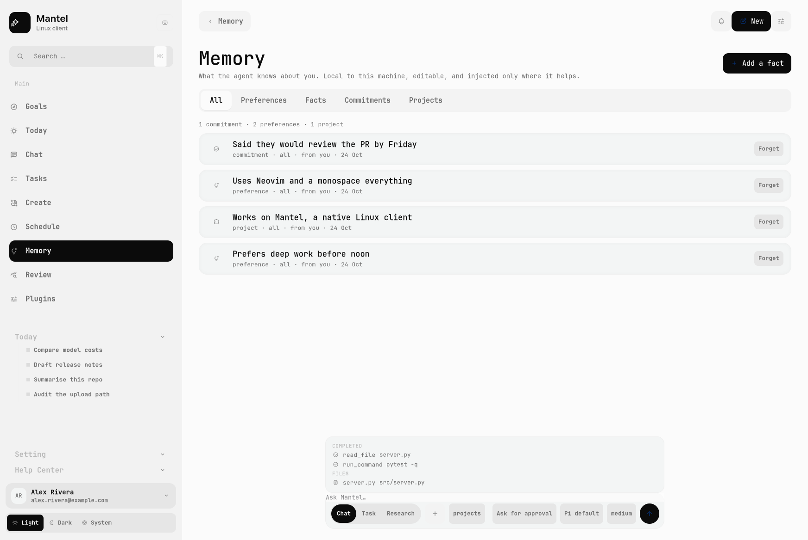
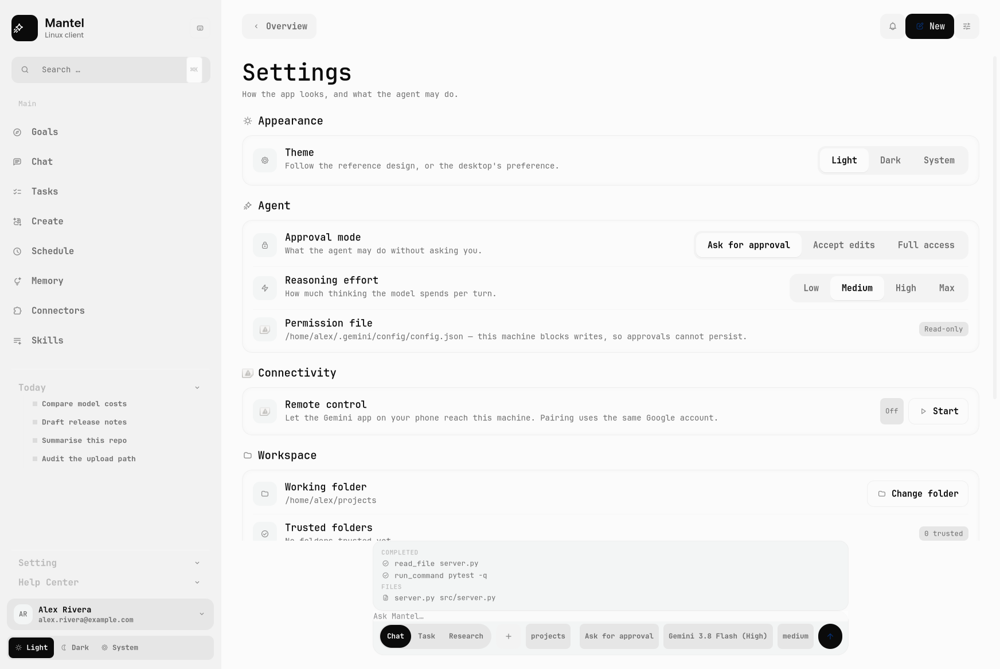

# Mantel

**A native GTK4 desktop for AI agents on Linux.** No Electron, no web wrapper:
a design-led shell with approvals you can see, work you can follow, and
conversations that outlive the process.



> Unofficial and unaffiliated with any model vendor. The shell follows a
> measured design language; see [Design credit](#design-credit).
>
> Where the product goes next — a day-planner agent with auditable memory and a
> plugin system — is in [docs/VISION.md](docs/VISION.md).

## Why this exists

Linux has no native desktop for agentic AI. What exists is either a browser
tab, an Electron shell around the same website, or a terminal.

There is a second reason, and it is the one that started this project. Access
to the newest models is decided by *which client surface you use*, not by what
you pay for: models can be available in a web app and withheld from the CLI or
the API tier you are actually entitled to. A desktop client that runs on Linux
should not be the thing standing between you and the model you already have.

So the premise here is: **the desktop shell is the product, and the engine is
swappable.** Mantel gives the terminal-first agent world the thing it lacks —
a native Linux surface — without owning the intelligence itself.

## What it does

**Agent surface, not a chat box**

- **Approvals with a real ladder**: allow once / allow for this session /
  always allow in this folder / deny — resolved before the tool runs, not
  reported after it failed.
- A **work panel** above the prompt: what completed, what is running, what is
  planned, which files were touched.
- A **changes panel** that asks git what actually changed on disk, with a diff
  viewer. The working tree is the source of truth, not the agent's claims.
- **Steering**: type while a turn is running and the instruction joins it —
  delivered after the current tool calls, shown as a note rather than a second
  user turn.
- **Tasks and reminders**: a local list you write the way you say it — “pay
  the invoice tomorrow at 5pm” becomes a dated task — with projects, repeats,
  an overdue state and time-based notifications while the app is open. The
  agent writes to the same store.
- **Memory you can inspect**: facts and preferences the agent knows about you,
  gathered from what you state plainly or added by hand, injected into each
  turn under a token budget — and listed with their source, age and expiry so
  you can forget any of them. Local to the machine; contradictions supersede
  rather than pile up.
- Three modes — **Chat**, **Task** and **Research** — with model and reasoning
  effort per conversation.

**Desktop application, not a page**

- Native GTK4 + libadwaita, measured against a design system
  ([docs/DESIGN.md](docs/DESIGN.md)) at 1744 × 1168.
- **Scheduled** prompts on a five-field cron, run by an in-app timer.
- **Connectors** (MCP) and **Skills**, with the engine's own stores as the
  source of truth.
- Screen capture attached to a prompt, image generation with a gallery, quick
  chat on a global hotkey, desktop notifications, light/dark/system themes.

## Screenshots

| | |
|---|---|
|  |  |
|  |  |
|  |  |

Every image is an offscreen render of the real widget tree, produced by
`tools/make_screenshots.py`. They use demo data, so no real account or path
appears in them.

## Engines

The client talks to an **engine adapter** — a small module that owns one
subprocess protocol. The UI, approvals, work panel, changes, schedules and
stores are engine-independent.

| Engine | Status | Notes |
|---|---|---|
| **Pi** ([pi.dev](https://pi.dev)) | **M3 complete — default target** | `pi --mode rpc`: streaming, tool events, models, effort, abort, sessions, and **pre-execution approvals** through the shipped gate extension (`pi-extensions/approvals.ts`). Verified against `pi` 1.4.0 and a protocol fake. Durability lands in M4. |
| **Gemini API** ([`google-genai`](https://pypi.org/project/google-genai/)) | planned | Direct SDK integration for people who want Gemini models with their own API key, including the Live API for voice. |
| **Legacy vendor engine** | v0.1 only, being removed | The current working bridge drives a bundled CLI engine. It is why this repo exists and is documented in [docs/reverse-engineering/](docs/reverse-engineering/), but it depends on vendor-issued credentials and is not the future. |

Swapping engines changes what the app *offers*, not how it feels: the same
approval cards, work panel and transcript, and only the surfaces the engine can
back. Run with `MANTEL_ENGINE=pi` and Connectors, Skills and the vendor account
page are simply not there — no dead links, no fake settings. The adapter tests
assert both halves of that.

## Run it

```bash
git clone https://github.com/<you>/mantel && cd mantel
./packaging/install.sh       # launcher + desktop entry, no root
mantel
```

**No engine and no account? Look at the UI anyway.** Demo mode fills the window
with sample content and touches neither your data nor the network:

```bash
python3 -m app.main --demo
```

Requirements: Linux with GTK4 and libadwaita, Python 3.10+ (developed and
tested on 3.14), PyGObject, Pycairo, and an engine on `PATH`.

```bash
# Debian/Ubuntu
sudo apt install python3-gi python3-gi-cairo gir1.2-gtk-4.0 gir1.2-adw-1 \
                 python3-cairo
# Fedora
sudo dnf install python3-gobject gtk4 libadwaita python3-cairo
```

Useful flags: `--workspace ~/code`, `--quick` (overlay), `--page chat`,
`--scheme dark`, `--demo`.

### The pixel-accurate look is optional

The design was measured against a reference that uses typefaces and an icon
glyph set this repository cannot redistribute. Without them the client falls
back to system fonts and stock symbolic icons and still lays out correctly —
that is what a fresh clone looks like. To get the look in the screenshots,
supply your own copies: [assets/README.md](assets/README.md).

## How it works

```
┌──────────────────────────────┐          ┌─────────────────────────────┐
│  GTK4 + libadwaita shell     │          │  engine adapter             │
│                              │          │  (Pi RPC · Gemini SDK · …)  │
│  rail · composer · pages     │  JSONL   │                             │
│    │      │                  │ ────────►│  pi --mode rpc              │
│    │      └─ session ────────┼─ events  │  multi-provider models      │
│    │                         │◄──────── │  durable conversations      │
│  chat · work · changes       │          │                             │
│  approvals · schedules       │  UI req  │                             │
│                              │◄──────── │  tool approval → card       │
└──────────────────────────────┘          └─────────────────────────────┘
```

- [docs/VISION.md](docs/VISION.md) — the product thesis and feature plan.
- [docs/ARCHITECTURE.md](docs/ARCHITECTURE.md) — modules, data flow, decisions.
- [docs/DESIGN.md](docs/DESIGN.md) — the design system, measured.
- [docs/plan/pi-engine.md](docs/plan/pi-engine.md) — the migration to Pi as the
  first engine, with milestones and acceptance criteria.
- [docs/reverse-engineering/](docs/reverse-engineering/) — how this started.

## How this started

The first version was a study of an existing desktop app: what protocol it
speaks, where it keeps its permissions, how it streams a turn. That work is
still here, because it is the same shape a desktop agent needs — and because
recovering a protocol from a shipped binary is a useful thing to be able to do.

Three findings from that study shaped this client:

1. **An engine that can ask mid-turn makes approvals real.** Pi's extension UI
   protocol lets the gate stop a tool before it runs, so "Deny" means the call
   never happened — not that it failed and was reported afterwards.
2. **Permissions live in a config file the client can own.** So a grant is a
   rule the engine honours, not a flag the UI pretends to keep.
3. **The stream is one-directional and accepts a single input event.** So
   approvals cannot pause a turn — which is exactly the gap Pi's extension UI
   protocol fills.

See [docs/reverse-engineering/](docs/reverse-engineering/).

## Tests

```bash
python3 tests/test_schedules.py          # cron maths, store, pause/resume
python3 tests/test_changes.py            # the git reader, on a real repo
python3 tests/test_context_fallback.py   # replayed history when resume fails
python3 tests/test_extras.py             # parsers for remote/screenshot/create
python3 tests/test_signin.py             # OAuth against a mock, incl. bad CSRF
python3 tests/test_engine.py "Say OK"    # the live engine bridge
python3 tests/test_agent_flow.py         # refuse -> approve -> the file appears
python3 tests/test_scheduler_run.py      # a schedule fires a real agent turn
```

The last three need an engine on `PATH` and skip cleanly without one. They are
the point of the project: approvals and scheduling are proven against a real
engine, not a mock.

## Limitations, honestly

- **Engine migration is in progress.** The working bridge today is the legacy
  vendor engine; Pi is the target and the reason for this rewrite. Until it
  lands, the app is not quite the thing this README describes.
- **Approvals cannot pause a vendor turn.** The legacy stream accepts one input
  event, so a granted action costs a retry. The Pi path resolves approvals
  before the tool runs.
- **Durability is not wired yet.** Conversations survive restarts through a
  local store, but not the way Pi Durable commits state; scheduled prompts only
  run while the app is open.
- **No voice yet.** It arrives with the Gemini API engine (Live API).
- **Third-party assets are optional and unshipped**, so a fresh clone is
  typographically plain by design.

## Design credit

The interface follows the **"Hearth" concept dashboard by
[@UiRahMan92](https://x.com/UiRahMan92)**. The grid, the rhythm and the muted
palette are theirs; the measurements in [docs/DESIGN.md](docs/DESIGN.md) are
mine.

## Licence

MIT — see [LICENSE](LICENSE). That covers this repository's code and
documentation only; no assets extracted from any third-party application are
included.
