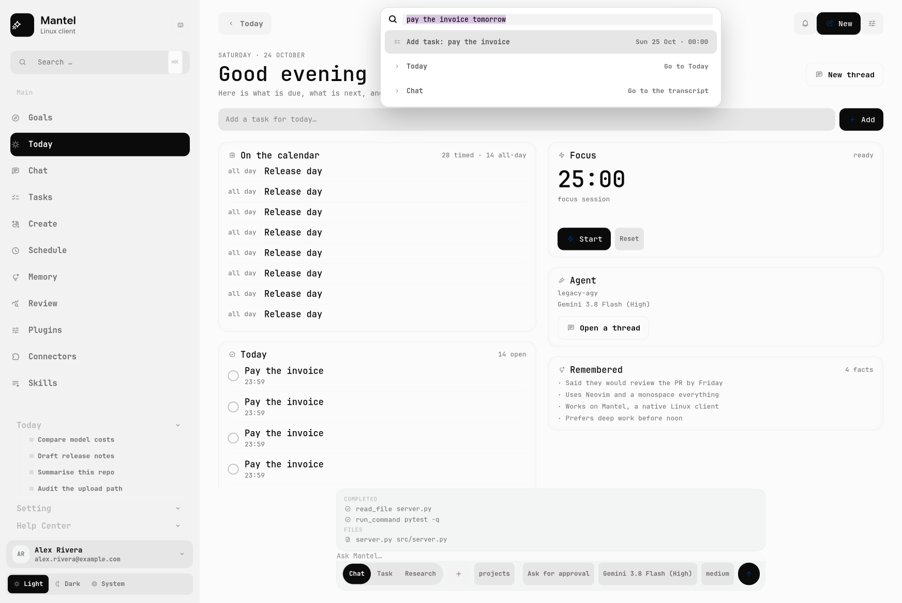
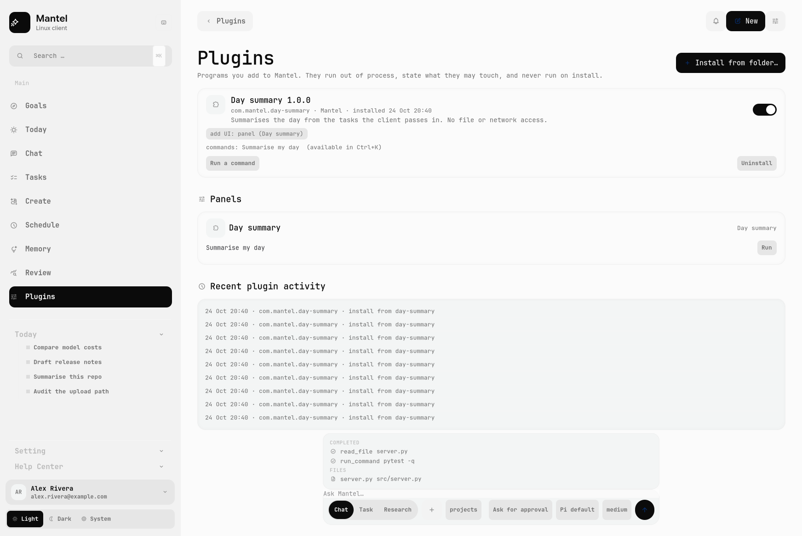
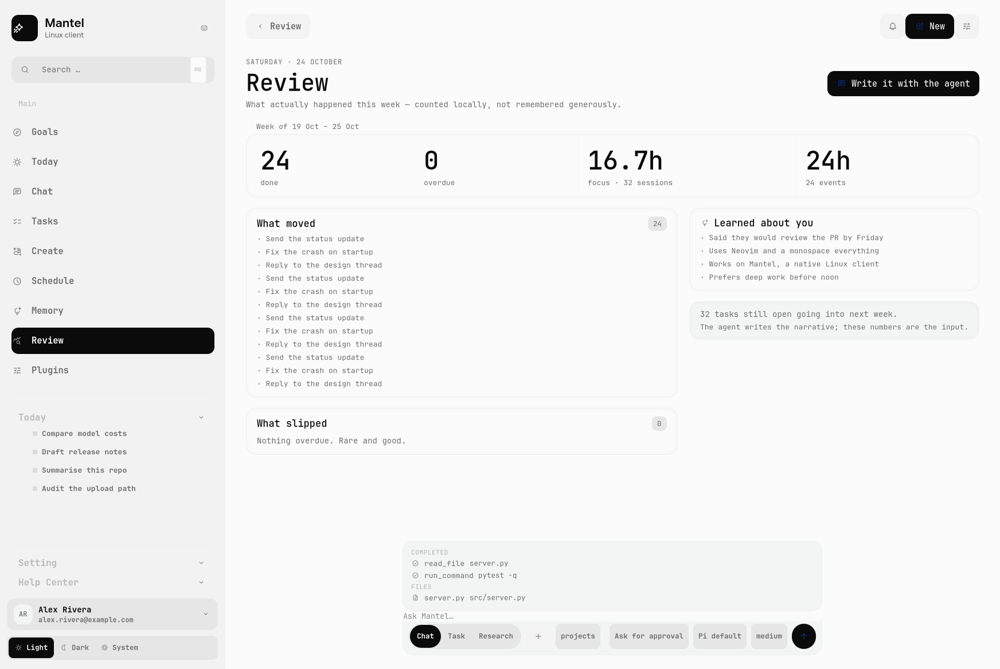

# Mantel

**A native GTK4 desktop for AI agents on Linux.** No Electron, no web wrapper:
a design-led shell with approvals you can see, work you can follow, and
conversations that outlive the process.


> Unofficial and unaffiliated with any model vendor. The shell follows a
> measured design language; see [Design credit](#design-credit).
>
> Where the product goes next — a day-planner agent with auditable memory and a
> plugin system — is in [docs/VISION.md](docs/VISION.md).

## Why this exists

Linux has no native desktop for agentic AI. What exists is either a browser
tab, an Electron shell around the same website, or a terminal.

There is a second reason, and it is the one that started this project. Access
to the newest models is decided by *which client surface you use*, not by what
you pay for: models can be available in a web app and withheld from the CLI or
the API tier you are actually entitled to. A desktop client that runs on Linux
should not be the thing standing between you and the model you already have.

So the premise here is: **the desktop shell is the product, and the engine is
swappable.** Mantel gives the terminal-first agent world the thing it lacks —
a native Linux surface — without owning the intelligence itself.

## What it does

**A day, not a dashboard**

- **Today** is the home screen: what is due (overdue first), what is next this
  week, what the agent remembers, and the agent itself — with a quick-add box
  that turns "pay the invoice tomorrow at 5pm" into a dated task.
- **Knowledge connectors**: point the agent at folders of your own notes and
  it retrieves relevant passages for each turn — local, read-only, incremental
  by mtime, capped so a large vault stays cheap. Lexical retrieval, not
  embeddings: it says so rather than pretending.
- **Schedules are threads**: a recurring prompt runs while the app is open and
  leaves a conversation of its own — open it from the Schedule page and read
  the run like any other turn. A run that was in flight when the app died is
  recoverable like a chat turn.
- **Survives a crash**: a turn in flight is recorded; if the app dies, the
  conversation reopens with the interrupted turn marked and one click to
  continue — no lost thread, no silent "running" state.
- **Plan the day**: proposes time blocks for the day's pressing tasks inside
  the real gaps between meetings — with buffers, no overlaps, and a plain
  "did not fit" list. Export it as an `.ics` if you want it in your calendar;
  the app does not write to it.
- **Quiet proactivity**: bounded nudges — something starting soon, too much
  late, one morning brief — capped by a daily budget (default three) and quiet
  hours, both configurable in Settings. The app is allowed to volunteer
  information; it is not allowed to become a notification feed.
- **Weekly review**: counted from the app's own records — tasks finished,
  what slipped, focus hours, calendar hours, facts learned, compared with last
  week — with one button that hands those numbers to the agent to write the
  narrative.
- **Calendar, read-only**: point it at an `.ics` export from any provider and
  the day's events appear on Today and in Settings — no account, no OAuth, no
  network. Recurrences (daily, weekly, monthly) and all-day events are
  expanded; UTC is converted to local.
- **Focus timer** lives on that screen, because a timer on its own page is a
  timer nobody starts.
- **Command palette** (`Ctrl+K`): type what you mean — a task ("pay the
  invoice tomorrow"), a note, a question, a page, or a command. It is also the
  capture path from outside the app: `mantel --capture "call the dentist
  tomorrow"` adds a task without opening a window, ready for a compositor
  hotkey.
- The older overview dashboard is still there as *Goals* while the two
  surfaces merge.

**Agent surface, not a chat box**

- **Approvals with a real ladder**: allow once / allow for this session /
  always allow in this folder / deny — resolved before the tool runs, not
  reported after it failed.
- A **work panel** above the prompt: what completed, what is running, what is
  planned, which files were touched.
- A **changes panel** that asks git what actually changed on disk, with a diff
  viewer. The working tree is the source of truth, not the agent's claims.
- **Steering**: type while a turn is running and the instruction joins it —
  delivered after the current tool calls, shown as a note rather than a second
  user turn.
- **Tasks and reminders**: a local list you write the way you say it — “pay
  the invoice tomorrow at 5pm” becomes a dated task — with projects, repeats,
  an overdue state and time-based notifications while the app is open. The
  agent writes to the same store.
- **Plugins**: a folder with a `mantel.json` and a program adds commands to the
  palette — and, as data rather than markup, small panels to the Plugins page or
  Today. They run out of process with a per-call timeout, state what they may
  touch, are never executed on install, and every action lands in an audit log.
  [docs/PLUGINS.md](docs/PLUGINS.md) has the contract; `plugins/day-summary` is a
  working example with a declared panel.
- **Memory you can inspect**: facts and preferences the agent knows about you,
  gathered from what you state plainly or added by hand, injected into each
  turn under a token budget — and listed with their source, age and expiry so
  you can forget any of them. Local to the machine; contradictions supersede
  rather than pile up.
- Three modes — **Chat**, **Task** and **Research** — with model and reasoning
  effort per conversation.

**Desktop application, not a page**

- Native GTK4 + libadwaita, measured against a design system
  ([docs/DESIGN.md](docs/DESIGN.md)) at 1744 × 1168.
- **Scheduled** prompts on a five-field cron, run by an in-app timer.
- **Connectors** (MCP) and **Skills**, with the engine's own stores as the
  source of truth.
- Screen capture attached to a prompt, image generation with a gallery, quick
  chat on a global hotkey, desktop notifications, light/dark/system themes.

## Screenshots

| | |
|---|---|
|  |  |
|  |  |
|  |  |
|  |  |
|  |  |

Every image is an offscreen render of the real widget tree, produced by
`tools/make_screenshots.py`. They use demo data, so no real account or path
appears in them.

## Engines

The client talks to an **engine adapter** — a small module that owns one
subprocess protocol. The UI, approvals, work panel, changes, schedules and
stores are engine-independent.

| Engine | Status | Notes |
|---|---|---|
| **Pi** ([pi.dev](https://pi.dev)) | **default engine** | `pi --mode rpc`: streaming, tool events, models, effort, abort, sessions, steering, compaction, crash recovery, and **pre-execution approvals** through the shipped gate extension (`pi-extensions/approvals.ts`). Verified against `pi` 1.4.0 and a protocol fake. |
| **Gemini API** | **implemented (chat, streaming, tools, approvals)** — set `GEMINI_API_KEY` | Speaks the public REST streaming API directly, with no third-party Python dependency. A real tool loop: `read_file` runs freely; `write_file` and `run_command` ask through the same approval cards every other engine uses, and a deny means the tool never runs. Verified against a local fake API — no key needed in CI. |

Swapping engines changes what the app *offers*, not how it feels: the same
approval cards, work panel and transcript, and only the surfaces the engine can
back. With `GEMINI_API_KEY` the client runs on the public API; with `pi` it
runs on your own provider credentials. The adapter contract tests assert both
halves of that.

## Run it

```bash
git clone https://github.com/<you>/mantel && cd mantel
./packaging/install.sh       # launcher + desktop entry, no root
mantel
```

**No engine and no account? Look at the UI anyway.** Demo mode fills the window
with sample content and touches neither your data nor the network:

```bash
python3 -m app.main --demo
```

Requirements: Linux with GTK4 and libadwaita, Python 3.10+ (developed and
tested on 3.14), PyGObject, Pycairo, and an engine — either `pi` on `PATH`
(the default) or a Gemini API key in `GEMINI_API_KEY`. There is no vendor
account, no OAuth and no bundled CLI.

```bash
# Debian/Ubuntu
sudo apt install python3-gi python3-gi-cairo gir1.2-gtk-4.0 gir1.2-adw-1 \
                 python3-cairo
# Fedora
sudo dnf install python3-gobject gtk4 libadwaita python3-cairo
```

Useful flags: `--workspace ~/code`, `--quick` (overlay), `--page chat`,
`--scheme dark`, `--demo`.

### The pixel-accurate look is optional

The design was measured against a reference that uses typefaces and an icon
glyph set this repository cannot redistribute. Without them the client falls
back to system fonts and stock symbolic icons and still lays out correctly —
that is what a fresh clone looks like. To get the look in the screenshots,
supply your own copies: [assets/README.md](assets/README.md).

## How it works

```
┌──────────────────────────────┐          ┌─────────────────────────────┐
│  GTK4 + libadwaita shell     │          │  engine adapter             │
│                              │          │  (Pi RPC · Gemini SDK · …)  │
│  rail · composer · pages     │  JSONL   │                             │
│    │      │                  │ ────────►│  pi --mode rpc              │
│    │      └─ session ────────┼─ events  │  multi-provider models      │
│    │                         │◄──────── │  durable conversations      │
│  chat · work · changes       │          │                             │
│  approvals · schedules       │  UI req  │                             │
│                              │◄──────── │  tool approval → card       │
└──────────────────────────────┘          └─────────────────────────────┘
```

- [docs/PLUGINS.md](docs/PLUGINS.md) — the plugin contract and security model.
- [SECURITY.md](SECURITY.md) — trust model, the approval gate, and what is
  deliberately not sandboxed.
- [CONTRIBUTING.md](CONTRIBUTING.md) — setup, the two gates, and the ground
  rules for the engine seam.
- [docs/VISION.md](docs/VISION.md) — the product thesis and feature plan.
- [docs/ARCHITECTURE.md](docs/ARCHITECTURE.md) — modules, data flow, decisions.
- [docs/DESIGN.md](docs/DESIGN.md) — the design system, measured.
- [docs/plan/pi-engine.md](docs/plan/pi-engine.md) — the migration to Pi as the
  first engine, with milestones and acceptance criteria.
- [docs/reverse-engineering/](docs/reverse-engineering/) — how this started.

## How this started

The first version was a study of an existing desktop app: what protocol it
speaks, where it keeps its permissions, how it streams a turn. That work is
still here, because it is the same shape a desktop agent needs — and because
recovering a protocol from a shipped binary is a useful thing to be able to do.

Three findings from that study shaped this client:

1. **An engine that can ask mid-turn makes approvals real.** Pi's extension UI
   protocol lets the gate stop a tool before it runs, so "Deny" means the call
   never happened — not that it failed and was reported afterwards.
2. **Permissions live in a config file the client can own.** So a grant is a
   rule the engine honours, not a flag the UI pretends to keep.
3. **The stream is one-directional and accepts a single input event.** So
   approvals cannot pause a turn — which is exactly the gap Pi's extension UI
   protocol fills.

See [docs/reverse-engineering/](docs/reverse-engineering/).

## Tests

```bash
make test-offline   # 17 suites, no engine and no network
make lint           # ruff, pinned, same version as CI
```

Two things are worth knowing about the suite. It is **offline by design**:
engine behaviour is exercised through protocol-faithful fakes
(`tests/fixtures/fake_pi.py`, `tests/fixtures/fake_gemini.py`), so the contract,
approval, kill-9 and scheduling tests run anywhere. And it is **behavioural** —
the assertions are about what happened on disk, not what the transcript says: a
denied write leaves no file, a completed task counts once, a killed app leaves a
recoverable thread.

## Limitations, honestly

- **Durability is not wired yet.** Conversations survive restarts through a
  local store, but not the way Pi Durable commits state; scheduled prompts only
  run while the app is open.
- **No voice yet.** It arrives with the Gemini API engine (Live API).
- **Third-party assets are optional and unshipped**, so a fresh clone is
  typographically plain by design.

## Design credit

The interface follows the **"Hearth" concept dashboard by
[@UiRahMan92](https://x.com/UiRahMan92)**. The grid, the rhythm and the muted
palette are theirs; the measurements in [docs/DESIGN.md](docs/DESIGN.md) are
mine.

## Licence

MIT — see [LICENSE](LICENSE). That covers this repository's code and
documentation only; no assets extracted from any third-party application are
included.
