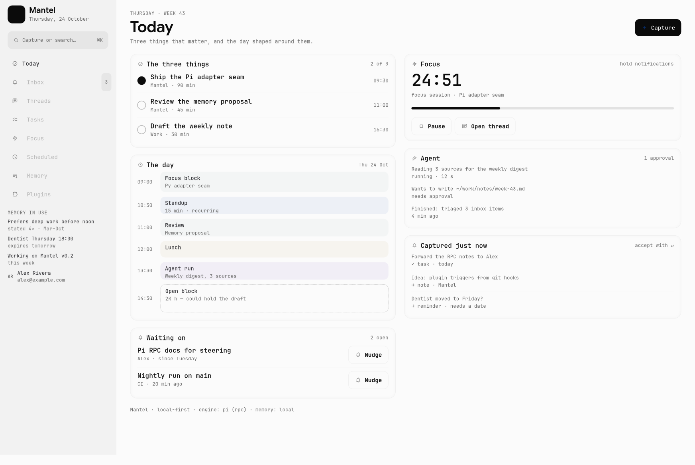

# Mantel — product vision

**Mantel is the desktop that runs your day.** Capture anything, let the agent
plan it, do it and follow up — with memory you can see and approvals you
control. Local-first, on Linux, with the engine you choose.



*The proposed home screen: three things that matter, the day shaped around
them, focus, the agent's activity, and what was just captured. Rendered by
`tools/make_vision_mock.py` from the real design system — a design mock, not a
shipped screen.*

This document is the product thesis behind the engine migration. It is a
positioning and feature document, not a promise of dates; the engineering plan
lives in [plan/pi-engine.md](plan/pi-engine.md).

---

## 1. The problem

The market already has calendars, todo lists, note apps and chat assistants.
What it does not have is a tool that keeps the *system* running. So people
assemble a stack, then maintain it by hand: retype meetings into tasks, move
blocks when the day slips, re-read old notes to remember context, and re-explain
themselves to an AI every morning.

Two failure modes explain why this stack collapses, and both are about
maintenance rather than features:

- **Trust collapse under overload.** The moment the list exceeds what can be
  done, the plan stops being believable — and a plan you don't believe is a plan
  you stop opening. One widely-shared account of productivity-tool churn puts it
  bluntly: past ~50 items due on the same day, "the system collapses; you stop
  trusting the app, stop checking it, and eventually stop using it."
  ([MakeUseOf](https://www.makeuseof.com/didnt-realize-time-wasting-productivity-apps/))
- **Habit debt.** Games create obligation through reward loops and social apps
  through other people. Productivity tools have to *earn* every open; the moment
  they cost more attention than they return, the streak ends.
  ([FoxData](https://foxdata.com/en/blogs/why-users-stop-using-productivity-apps-and-how-to-fix-it/))

AI assistants did not fix this. They added a chat box beside the stack. They
forget everything between conversations, cannot act in most products, and ask
you to trust a memory you cannot inspect. Meanwhile, *which* model you get is
increasingly decided by which client surface you use — and on Linux there is no
native desktop at all.

**The gap: an agent that maintains the day, not another tool you maintain.**

## 2. Who it is for

Primary: the technical Linux user who lives on the keyboard — developer,
researcher, ops, founder-of-one. They already have opinions about tools, they
will not move their whole life to a SaaS, and they are unreasonably happy to pay
for something that feels *theirs*.

Secondary: the overloaded multi-project person on GNOME/KDE who has tried Motion
or Sunsama, found the calendar-first planning rigid and cloud-only, and wants the
planning intelligence without surrendering the data.

We are not building for teams first. Multiplayer is a later phase, enabled by
the harness, not the opening bid.

## 3. Product principles

1. **The day is the interface.** The home screen is today's plan, not a
   dashboard of metrics. If a surface does not help you decide what to do in the
   next hour, it does not belong on the first screen.
2. **Zero-friction capture.** One global hotkey, from anywhere, under two
   seconds: text, screenshot, clipboard, file, voice later. Classification is the
   agent's job, not yours.
3. **The agent does the maintenance.** Triage, scheduling, rescheduling,
   reminders, follow-ups, weekly review. You approve; it works.
4. **Every automated decision is visible and reversible.** Approvals before
   actions, an undo after them, and a log of what happened while you were not
   looking.
5. **Memory must be auditable.** You can see every fact the agent believes, why
   it believes it, when it will expire, and delete it — and see *why* a memory
   was recalled.
6. **Local-first, provider-agnostic.** Your data in one directory on your disk;
   your model key, your choice of engine. Sync is opt-in, never required.
7. **Quiet by default.** Proactive, but bounded: a budget of nudges per day,
   quiet hours, and one digest instead of ten pings.
8. **Everything is a plugin.** The features we do not build, someone will — and
   they should not have to fork the app to do it.

## 4. The loop

```
        capture            triage             plan            do            review
   ┌──────────────┐   ┌──────────────┐   ┌───────────┐   ┌──────────┐   ┌──────────┐
   │ hotkey: text │   │ agent: type, │   │ Today:    │   │ focus    │   │ end-of-  │
   │ screenshot   │──►│ project,     │──►│ 3 things, │──►│ sessions │──►│ day +    │
   │ clipboard    │   │ estimate,    │   │ timeline, │   │ threads  │   │ weekly   │
   │ file, voice  │   │ suggest when │   │ waiting-on│   │ timers   │   │ reviews  │
   └──────────────┘   └──────────────┘   └───────────┘   └──────────┘   └──────────┘
             ▲                                                                    │
             └───────────────────── memory: facts, preferences, commitments ──────┘
```

Every stage is a place where a normal productivity app asks *you* to do work.
That is where the agent earns its keep.

## 5. Surfaces

The shell we have today (rail + page stack + work panel + approvals + changes)
is the chassis. Here is what hangs on it.

| Surface | What it is | Status |
|---|---|---|
| **Today** | home: agenda timeline (calendar + tasks + reminders merged), the three things that matter, waiting-on, next free block, agent activity | new (replaces the stats dashboard) |
| **Capture / Inbox** | global hotkey; unfiled items; agent proposes classification; accept with one key | new |
| **Tasks** | todos with natural-language dates and recurrence, priorities, waiting-on, project tags | exists as a list, needs a real model |
| **Reminders** | time- and context-triggered; fire at the right surface, not just a notification | new |
| **Threads** | conversations as durable, resumable threads with a memory scope and linked tasks | exists as chat, needs durability |
| **Scheduled** | recurring prompts the agent runs (morning brief, weekly review) | exists, needs durability |
| **Focus** | timers and focus sessions; agent holds interruptions and re-plans around them | new |
| **Calendar** | read first (ICS/CalDAV), write later (time-blocking proposals) | new |
| **Memory** | inspectable facts and profile: view, edit, forget, export; recall explainer | new |
| **Plugins** | browse/install/configure extensions, connectors and skills | new (connectors exist) |
| **Review** | end-of-day and weekly: what moved, what slipped, what to carry | new |
| **Agent surfaces** | transcript, work panel, approvals, changes | exists |

## 6. Feature set

### P0 — the minimum that is genuinely useful daily

> **Shipped so far:** the task store with natural-language dates, repeats,
> projects and reminders (`app/todos.py`), the Tasks page, the reminder runner,
> and Memory v1. Today's merged agenda, capture-from-anywhere and the command
> palette are still to come.

| # | Feature | Why it earns the open | Acceptance |
|---|---|---|---|
| 1 | **Today** with merged agenda and "three things" | answers "what now?" in one glance | renders in <150 ms; three things editable inline |
| 2 | **Global capture** (hotkey → inbox) | lower friction than any other tool you have | hotkey to filed item <2 s, works with app unfocused |
| 3 | **Agent triage** propose type/date/project | removes the maintenance tax | one keystroke accepts; rejected suggestions are not re-proposed |
| 4 | **Tasks + reminders** with NL dates and recurrence | the baseline expectation | "every second tuesday 4pm" parses; reminder fires on time, offline |
| 5 | **Threads** with durability | the reason to keep the app open | kill the app mid-turn, relaunch, thread continues |
| 6 | **Memory v1**: profile + facts, local | the agent knows you, and you can prove it | facts visible with source + date; forget removes it from recall |
| 7 | **Command palette** (Ctrl+K) for everything | keyboard-first users switch for this alone | every action reachable; fuzzy, instant |
| 8 | **Focus session** with a timer and agent-guarded interruptions | the thing people actually use timers for | session start/pause/stop; plan adjusts around it |
| 9 | **Approvals + work panel** | trust in an agent that acts | already built; now pre-execution on Pi |
| 10 | **End-of-day review** | closes the loop, builds the habit | one screen, three questions, carries unfinished work forward |

### P1 — what makes it sticky

- **Time-blocking proposals**: agent drafts the day onto the calendar; you
  accept, drag, or reject. Re-plans automatically when a block slips.
- **Bounded proactivity**: morning brief, "you're behind on X", "this block is
  about to start" — with a daily nudge budget, quiet hours, and a single digest.
- **Plugin system v1** (see §8) plus five reference plugins.
- **Memory connectors**: a folder, an Obsidian vault, GitHub, calendar; opt-in,
  per-source.
- **Weekly review and insights**: where the time went, what moved, what keeps
  slipping — from real data, not vibes.
- **Capture everything**: clipboard, screenshot with OCR-in-memory, drag-and-drop
  file, quick voice note.
- **Linking**: a task can open a thread; a thread can become tasks; a project
  groups both.
- **Mobile/remote capture**: a tiny local HTTP endpoint plus Pi Durable's
  multi-client attach, so a phone can add to the inbox or watch a run.

### P2 — the long tail

- **Multiplayer**: share one harness with a partner or assistant — both clients
  can watch and steer the same conversation (Pi Durable makes this native).
- **Habit tracking and streaks**, energy-aware scheduling.
- **Email triage** into inbox items (IMAP first, Gmail via MCP).
- **Automation builder**: "when X, do Y" over plugin triggers, no code.
- **Notes workspace**: a lightweight local knowledge base the agent can write to.
- **Voice conversation** (Gemini Live via the Gemini engine).

### Anti-features

No team chat, no social feed, no "AI writes your emails" spray, no mandatory
cloud account, no gamified guilt, no plan that pretends a day has 30 hours. If a
feature increases maintenance, it is out.

## 7. Memory: the part that makes it *yours*

> **v1 shipped.** `app/memory.py` and the Memory page implement the local
> store below: typed facts with source, reinforcement, expiry and
> supersession; a budgeted profile block injected into every turn; capture
> from plainly-stated preferences, projects and commitments; and
> forget/clear from the page. The provider interface and Supermemory backend
> are still to come.

The user's ask is explicit: the agent should know them. The design constraint is
equally explicit: they must be able to check.

**What is remembered**

| Layer | Contents | Lifetime |
|---|---|---|
| **Profile** | stable facts and preferences ("prefers mornings for deep work", "works at Acme") | until contradicted or forgotten |
| **Dynamic context** | current projects, recent activity, open loops | weeks, decays |
| **Episodic** | per-thread digests: what was decided, what was done | kept, searchable |
| **Commitments** | "I said I'd send the draft Friday" | until kept or expired |

**Provider abstraction.** Memory is an interface, not a database:

```
MemoryProvider:  add(content, scope) · search(q, scope, budget)
                 profile(scope) · forget(id) · export(scope)
```

Two providers ship: a **built-in local store** (SQLite + local embeddings,
zero-config, works offline) and **Supermemory** — either the local binary
(`localhost:6767`, data in `~/.supermemory`, Ollama-capable) or the hosted API
with the user's key. Supermemory is a strong fit because it already models what
this problem needs: fact extraction, contradiction resolution, **automatic
expiry** of temporary facts, and static/dynamic user profiles in ~50 ms
([supermemory](https://github.com/supermemoryai/supermemory)).

**Retrieval.** Always inject the profile (a few hundred tokens); add hybrid
memory+RAG results inside a token budget; rank by relevance × recency ×
importance; dedupe against the current turn. The engine sees context, not a
data dump.

**Trust UI (non-negotiable).**

- A **Memory page** listing every fact, with source, date, confidence and scope.
- **Forget** per fact, per scope, or everything; deletion is immediate and
  verified by a recall test.
- **"Why did it recall this?"** — the transcript shows the memories injected for
  that turn, with links back to their source.
- **Scopes**: work / personal per thread; never cross-injected by default.
- **Expiry** rules for temporal facts, and a visible history of contradictions
  resolved.

**Privacy.** Local embeddings by default, redaction of secrets before storage,
per-source opt-in for connectors, one directory to back up, and a single
"export/wipe" control.

**Evaluation.** Memory is tested like code: contradiction ("I moved to SF"),
expiry ("exam tomorrow"), preference recall, scope leakage, and a recall
latency budget. We will benchmark against [MemoryBench](https://supermemory.ai/docs/memorybench/overview)
rather than trusting vibes.

## 8. Plugins: how the app becomes *their* app

The biggest churn driver in productivity software is that everyone wants a
different 10 %. A plugin system turns that from a churn reason into a moat —
but only if it is trustworthy. MCP threat modelling shows exactly why: tool
descriptions are prompt surface, and a malicious plugin can try to poison the
model against its own user ([arXiv](https://arxiv.org/html/2603.22489v1),
[CSA guidance](https://labs.cloudsecurityalliance.org/agentic/agentic-mcp-security-best-practices-v1/)).
Raycast's answer is that extensions are open source and inspectable
([Raycast security](https://developers.raycast.com/information/security)). Ours
is capability tiers plus process isolation.

**Three tiers, by power and risk**

| Tier | What it is | Runs where | Can do |
|---|---|---|---|
| **Skill** | markdown instructions + optional scripts, agent-invoked | engine sandbox | extend how the agent works on a task |
| **Connector** | MCP server (stdio or HTTP) | its own process | expose tools from another service |
| **Extension** | a program contributing UI, commands, triggers, tools, memory hooks | its own process, JSON-RPC to Mantel | everything below, gated by capabilities |

**Manifest** (`mantel.json`)

```json
{
  "id": "com.example.focus-audio",
  "name": "Focus audio",
  "version": "1.2.0",
  "apiVersion": "1",
  "entry": { "command": ["python3", "main.py"] },
  "permissions": { "fs": ["workspace"], "net": ["api.example.com"],
                   "memory": "read", "exec": false, "ui": ["panel"] },
  "contributes": {
    "pages": [{ "id": "focus", "title": "Focus", "slot": "rail" }],
    "panels": [{ "id": "timer", "slot": "today.side" }],
    "commands": [{ "id": "focus.start", "title": "Start focus session" }],
    "triggers": [{ "id": "every-morning", "cron": "0 8 * * *" }],
    "tools": [{ "name": "set_focus_timer", "schema": "tools/timer.json" }],
    "settings": [{ "key": "theme", "type": "select", "options": ["rain", "cafe"] }]
  }
}
```

**Safety model**

- Install shows a **capability sheet** in the same voice as tool approvals:
  what it can read, what it can reach on the network, whether it can run code.
- Extensions run **out of process**; the host API is JSON-RPC, so a crashing or
  hostile plugin cannot take the app down with it.
- **UI is declarative**: plugins contribute pages, panels and commands from a
  constrained schema (cards, lists, forms, charts), so the design language
  survives contact with third-party code.
- **Provenance everywhere**: any tool a plugin provides is labelled with the
  plugin in the work panel and in approval cards.
- **Audit log** of plugin actions, a **kill switch**, and a safe mode that
  starts with all plugins disabled.
- **Distribution**: from a local directory, a git URL, or an index file with
  hashes. Signed index entries; unsigned plugins get a visible badge.

**Developer experience** is part of the feature: `mantel plugin new` scaffold,
hot reload, a dev console, a typed host API for Python (and JSON-RPC for
anything else), and a conformance test that a plugin must pass before it can be
listed.

**Reference plugins** ship with v1 to prove the seams: GitHub digest, calendar
sync, Obsidian vault linker, focus audio, morning weather brief.

## 9. What this means for the design

The current shell is a careful reproduction of a design we admire. That was the
right way to learn the craft; it is the wrong place to stop. The identity should
become ours while keeping what works: the muted palette, the monospaced rhythm,
the card language.

- **Home changes meaning**: from a metrics dashboard to **Today** — timeline,
  three things, waiting-on, agent activity. Decorative panels (targets, model
  status) are replaced by functional ones.
- **The command palette becomes primary**; the rail becomes orientation rather
  than navigation.
- **Our own iconography**: the current glyph set is the reference's. Drawing our
  own set is both a legal clean-up and the clearest signal that this is now our
  product.
- **A timeline component** is the one new primitive the design system needs:
  a vertical day rail that holds blocks, tasks, reminders and agent runs.
- **Chat gains structure**: threads with scope chips (work/personal), linked
  tasks, and memory-in-use annotations.

`DESIGN.md` will be updated with the evolution: "inspired by" becomes a
starting point with a diff, not a copy.

## 10. Roadmap

Product phases ride on the engine milestones, so the app is never claiming
something the harness cannot do.

| Phase | Engine | Product |
|---|---|---|
| **A — foundation** | M0–M2 (adapter seam, Pi, approvals) | Today v1, capture + inbox, tasks/reminders model, command palette, threads (durable) |
| **B — it knows you** | M3–M4 (tool parity, durability) | Memory v1 with trust UI, focus sessions, end-of-day review, first connectors |
| **C — it works while you don't** | M5 (durable tasks) | Time-blocking proposals, bounded proactivity, scheduled briefs, weekly review |
| **D — it's theirs** | M6 (Gemini engine, legacy gone) | Plugin system v1 + reference plugins, plugin index, mobile capture, voice |

Publish at **A**: "the desktop that runs your day" is a true claim the moment
capture, today, tasks and durable threads work.

## 11. How we would know it works

Local-first means opt-in telemetry, and honest metrics:

- **Activation**: capture → filed item in one session, without reading docs.
- **Habit**: D7 retention; days opened with a plan vs without.
- **Agent value**: agent actions per week; approval acceptance rate; proposals
  edited rather than rejected.
- **Trust**: memories viewed/edited; forget requests honoured; zero scope leaks
  in tests.
- **Memory quality**: benchmark suite pass rate (contradiction, expiry,
  preference recall).
- **Extensibility**: plugins installed per user; plugin-triggered actions.
- **Speed**: hotkey→inbox <2 s; Today renders <150 ms.

## 12. Open decisions

1. **Calendar source**: ICS/CalDAV read-only first, or a Google Calendar MCP
   connector? (The former is local-first; the latter is what people have.)
2. **Default memory provider**: built-in only at launch, or a guided
   Supermemory-local setup? (Recommendation: built-in default, Supermemory as
   the "advanced" provider.)
3. **Plugin language**: Python-only v1 (our stack) with JSON-RPC for others, or
   JSON-RPC-first from day one? (Recommendation: Python-first for DX, protocol
   from day one.)
4. **Plugin UI**: declarative schema only, or allow embedded web views for
   escape-hatch UIs? (Recommendation: declarative first; revisit if a real use
   case dies without it.)
5. **Voice**: local Whisper capture first, Gemini Live later, or wait for Live?
   (Recommendation: local capture is the product feature; Live is a bonus.)

## 13. Sources

- Supermemory — memory engine, profiles, expiry, local binary:
  [github.com/supermemoryai/supermemory](https://github.com/supermemoryai/supermemory)
- Memory benchmarking: [MemoryBench](https://supermemory.ai/docs/memorybench/overview),
  [LongMemEval](https://github.com/xiaowu0162/LongMemEval)
- Productivity abandonment: [FoxData](https://foxdata.com/en/blogs/why-users-stop-using-productivity-apps-and-how-to-fix-it/),
  [MakeUseOf](https://www.makeuseof.com/didnt-realize-time-wasting-productivity-apps/)
- Planning tools compared: [Sunsama vs Motion](https://thebusinessdive.com/sunsama-vs-motion),
  [Morgen](https://www.morgen.so/blog-posts/sunsama-vs-motion)
- Local AI assistants: [Vellum, best local assistants 2026](https://www.vellum.ai/blog/best-local-ai-assistants)
- Plugin security: [Raycast extensions security](https://developers.raycast.com/information/security),
  [MCP threat modelling](https://arxiv.org/html/2603.22489v1),
  [CSA agentic MCP best practices](https://labs.cloudsecurityalliance.org/agentic/agentic-mcp-security-best-practices-v1/)
- Consumer AI trust and privacy: [arXiv 2607.15134](https://arxiv.org/pdf/2607.15134)
