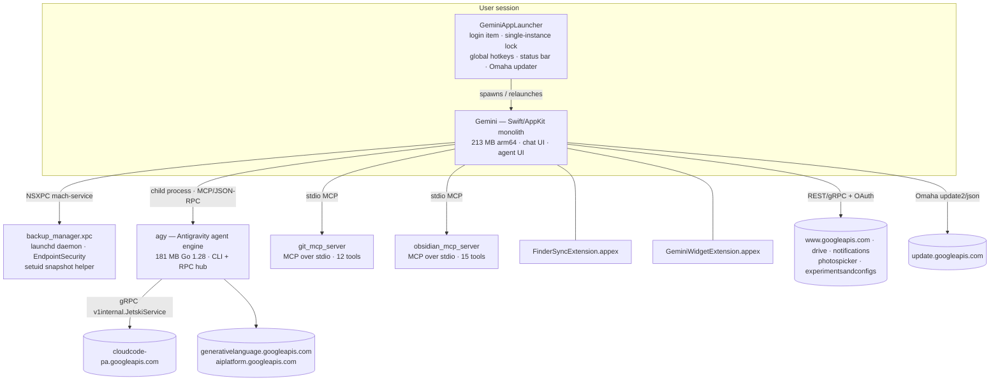

# Gemini Desktop 1.128.14.1166 — Reverse Engineering Report

**Target:** `Gemini.dmg` (Apple DMG, 237,988,020 B, SHA-256 `3dec19e96d5888f66d0117545292e5cdb3b9932e19567b1edb395f1b7678c915`)
**Host of analysis:** Linux x64, static analysis only (no emulation, no execution of target code).
**Method:** REA evidence ledger (4 Evidence records, exported to `gemini_evidence_bundle.json`) + host-side parsers (llvm-objdump/nm, plistlib, openssl) + strings sweeps. Claims are labeled [OBSERVED] (quoted from artifact) or [INFERRED] (analyst conclusion).
**Evidence index:** see §9. **Recovered protocol contracts:** `PROTOCOL_SPEC.md` (48 FileDescriptorProtos → 2,832 messages, 507 RPCs in `protos/`).

---

## 1. Artifact identity

| Fact | Value | Evidence |
|---|---|---|
| Volume | HFS+ UDIF, root folder `Gemini 1.128.14.1166/`, 3,019 files + 10 xattrs | 7z listing [OBSERVED] |
| App bundle root | SHA-256 `4f19a04a…17ebb7`, graph 854 nodes / 3,436 occurrences, **0 integrity contradictions** | `inventory_artifact` ev_68e49f19… |
| Main executable | `Contents/MacOS/Gemini`, 213,698,304 B, **arm64-only** Mach-O (MH_MAGIC_64, 122 load cmds, `__TEXT` 178 MB, `__text` 133 MB), SHA-256 `8cd89234…6f8964` | `open_binary`; llvm-objdump [OBSERVED] |
| Bundle ID / version | `com.google.GeminiMacOS` / 1.128.14.1166 (CFBundleVersion identical), LSMinimumSystemVersion 15.0 | Info.plist [OBSERVED] |
| Build toolchain | Xcode 2700 / SDK macosx27.0 (`DTSDKName: macosx27.0`) | Info.plist [OBSERVED] |
| Signing identity | Team `EQHXZ8M8AV` (Google LLC), profile "Gemini MacOS DeveloperID", App ID `EQHXZ8M8AV.com.google.GeminiMacOS`, expires 2044-08-27, ProvisionsAllDevices | embedded.provisionprofile [OBSERVED] |
| Updater channel | `KSChannelID: m1-prod` | Info.plist [OBSERVED] |
| URL schemes | `googlegemini`, `comgooglegemini`; document type `com.google.GeminiMacOS.chat`; "All Files" Viewer role | Info.plist [OBSERVED] |

**Entitlements** (`Gemini-expanded.entitlements` + profile) [OBSERVED]:

| Entitlement | Value | Meaning for porting |
|---|---|---|
| `com.apple.security.app-sandbox` | **false** | unrestricted FS/process access |
| `com.apple.developer.endpoint-security.client` | true | kernel-level file/process monitoring (backup daemon) |
| `com.apple.security.automation.apple-events` | true | "control other apps on your behalf" (Info.plist usage string [OBSERVED]) |
| `com.apple.developer.aps-environment` | production | APNs push |
| `com.apple.developer.associated-domains` | `*` | universal links |
| camera / audio-input / network client+server / user-selected read-only | true | Gemini Live voice/video, local servers |

---

## 2. Architecture

Nine arm64 executables, **zero bundled frameworks/dylibs/JS** (`project_apple_application_graph` shows `components.frameworks`, `native_libraries`, `javascript` all empty) — everything is statically linked. Third-party code is compiled in: **Lottie** (150 classes), **SVGView** (61), **SwiftNIO** (NIOCore/NIOPosix/NIOHTTP1/2/NIOSSL/NIOTransportServices…), **grpc-swift (GRPC)**, **MCP SDK**, Google **Tink** crypto protos, Envoy xDS protos.

| Executable | Size | SHA-256 (prefix) | Role [OBSERVED → INFERRED] |
|---|---|---|---|
| `MacOS/Gemini` | 213 MB | `8cd89234` | Main Swift/AppKit app: chat UI, agent UI, integrations |
| `Helpers/agy` | 181 MB | `4065d818` | **Google Antigravity agent engine** (Go) — see §3 |
| `Helpers/crashpad_handler` | 708 KB | `5b1dc6b8` | Chromium Crashpad crash reporter |
| `Helpers/git_mcp_server` | 7.7 MB | `1a135aa5` | Go MCP server, 12 git tools, stdio |
| `Helpers/obsidian_mcp_server` | 7.7 MB | `012b0c4f` | Go MCP server, 15 Obsidian tools, stdio |
| `Helpers/GeminiAppLauncher.app` | 5.3 MB | `7d477bbc` | LSUIElement supervisor: SMAppService login item, `flock` single-instance lock, global hotkeys (`SHIFT_OPTION_SPACE`, `HOLD_RIGHT_OPTION`, `DOUBLE_TAP_RIGHT_OPTION`, `DUAL_COMMAND`), status bar, **Omaha auto-update** (ksadmin, SHA-256-verified), restart orchestration |
| `XPCServices/backup_manager.xpc` | 524 KB | `996bfd8a` | Root LaunchDaemon `com.google.gemini.backupmanager`: EndpointSecurity client (`es_new_client/es_subscribe/es_respond_auth_result`) tracking one caller-supplied process (audit token) + `destPath`; **setuid BackupHelperProcess** mirrors file create/truncate/rename/unlink/copyfile into `destPath`; XPC gated to `com.google.GeminiMacOS`-signed clients. Source paths recovered: `googlemac/Janus/MacApplication/DesktopTools/Backups/{BackupManager,BackupHelperProcess,BackupListener}.mm` → agent-edit rollback/snapshot service [INFERRED] |
| `PlugIns/FinderSyncExtension.appex` | 216 KB | `5bea019a` | Finder sync extension |
| `PlugIns/GeminiWidgetExtension.appex` | 2.6 MB | `60f01a07` | WidgetKit widget |

Resource bundles (from `project_apple_application_graph`): AntigravityLogo, DriveIcons, KeepLogo, NotebookIcons, TasksLogo, GeminiIcons, MediaGenTemplatesAssets, GIPPseudonymousID, LuminousSymbols, mathFonts, GoogleSans\* fonts, **gRPCCertificates.bundle** (gRPC TLS roots). Resources: 1,837 `.strings`, 8 `.car` (Asset Catalog), 5 `.metallib` (AuroraShaders, NeuralGradientShaders, NeuralWavesShaders), 3 `.mp4`, 10 Lottie `.json` (`GPI_Aurora_Spark/Spinner`, `LuminousProgressIndicator` — Bodymovin format), `geoxp_map.html` (Mustache-style `{{FONT_FAMILY}}`-templated map WebView page).

---

## 3. The agent stack (core of the product)

### 3.1 `agy` — Antigravity agent engine [OBSERVED strings]

- **Identity:** `Antigravity` ×157, `AntigravityAgentConfig` ×37, `antigravity.google` ×28, `com.google.antigravity/ui` proto package.
- **Toolchain:** `go1.28-20260921-RC02 cl/985595000 +644cd61a4a X:fieldtrack,boringcrypto,simd`, `Go fipsinfo` → Google-internal FIPS/boringcrypto Go build. Module/deps table stripped.
- **Backend protocol:** `cloudcode-pa.googleapis.com/` + `v1internal.JetskiService` + `gemini_coder.AddStepsRequest`; also `aiplatform.googleapis.com` (×269), `generativelanguage.googleapis.com`, `sts.googleapis.com/v1/oauthtoken`, `oauth2/v2/userinfo`. Model strings: `Gemini 3.8 Flash`, `Gemini 3.5 Flash`. Feature flags via Unleash (`unleash-connection-id`).
- **RPC verb taxonomy** (protobuf request/response families): VCS ops — `Fig*` (Sapling), `Jj*` (jj-vcs), `Cog*` (Google VCS), `Repo*`, `Git*` (`GitCommit`, `GitStage`, `GitDiffEntry`, `GitEventWatcher`…); debug — `DumpPprof`, `DumpGoroutineStacks`, `DumpFlightRecorder`; MCP — `McpCall`, `McpApprovalRequest/Response`, `McpAuth`, `McpBrowserRecordingStart/StopHook`, `McpCommandTemplate`; agents/skills — `AgentManager`, `AgentInitiatedRPC`, `AgentScriptExecutor`, `spawn_agent`, `list_agents`, `skill_search`. ~11,764 `Agent*/Get*/Set*` protobuf symbols → very wide message surface.
- **CLI:** `Usage: %s <command> [arguments]`; subcommands/flags incl. `add-dir`, `--headless`, `cdp_port`, `start-cascade`, `recorded-rpcs`; management verbs `AuthStart`, `AuthLogout`, "List available models", "List available agents", "Disable an MCP server"; also shells `gcloud auth list`, `kubectl describe`.
- **Bundled tooling policy:** downloads `github.com/BurntSushi/ripgrep`, `astral-sh/python-build-standalone`, `cli/cli` (gh) release archives at runtime; embedded web assets (`www.gstatic.com/antigravity/web/dev/tailwindcss.min.js`), `.gemini/jetski/` paths.

### 3.2 Agent UI in the main binary (feature flags + classes) [OBSERVED]

`AgentMode__enable_agent_mode` · `enable_cowork_skills` · `enable_client_side_skills` · `enable_mcp_tools` · `enable_custom_mcp_apps` · `enable_custom_mcps_on_gemini_chat` · `enable_mcp_tool_ui_frame` · `enable_{git,obsidian,messages,blender}_bundled_mcp_tools` · `enable_remote_control` · `enable_async_mode` · `enable_dynamo` · `enable_remy_chat_convergence` / `enable_remy_steering` / `enable_remy_elicitation_*` ("Remy" agent persona) · `disable_network_access_confirmation` · `bundled_mcp_bypass_confirmation`.

Recovered classes: `SkillsManagerViewModelImpl`, `CreateSkillViewModelImpl`, `UploadSkillViewModelImpl`, `CustomMCPViewModel`, `MCPToolBlockNodeRenderer` (chat tool-call blocks), `AgentDynamicIslandController`, `AgentProgressNotchController`, `RemyModelThoughtTimeline`, `EvalAgentModeLauncher`, `RemoteControlLauncher`, `LocalHotKeyHandler`, `STCEscapeHotKey(Monitor)` (stream-to-cursor), `ScreenshotLasso*`, `AreaScreenshotService`, `ScreenContextCoordinator`, `PreservedChromeMonitor` (ComputerUse), `VirtualDisplayManager`/`OverlayCursor`/`WindowPrimitives`, `OmahaDirectInstaller`, `AppUpdaterServiceImpl`, `BrowserViewModel`, `VoiceServiceImplementation`, `ImageEditorUI`, `MediaGenTemplates*`, `CodeModeWebView`, `GmailCard`, `GmailDraftSyncCoordinator`, `TaskListView`, `MessageTree`/`ChatMessageTree`, `ChatInput`, `ConditionEvaluator`, `FeedbackScreenshotModel`.

### 3.3 MCP skill servers (fully recovered, Linux-portable) [OBSERVED]

Both from `gdm/apps/janus/mcp_server/…`, official **MCP Go SDK** (`modelcontextprotocol/go_sdk`), **stdio transport** ("starting MCP server over stdio"), JSON-RPC 2.0. Config via `MCP_TOOLS_METADATA` env.

- **git_mcp_server — 12 tools:** `git_init`, `git_status`, `git_diff`, `git_log`, `git_show`, `git_add`, `git_commit`, `git_checkout`, `git_branch`, `git_stash`, `git_push`, `git_pull` (full param schemas recovered: `repo_path`, `paths[]`, `message`, `amend`, `staged`, `limit`, `target`, `create_branch`, `name`, `delete`, `action`, `remote`, `branch`). Shells out to `git` (`GIT_TERMINAL_PROMPT=0`).
- **obsidian_mcp_server — 15 tools:** `obsidian_init_vault`, `_list_notes`, `_read_note`, `_create_note`, `_append_note`, `_patch_note`, `_delete_note`, `_move_note`, `_create_directory`, `_search_notes`, `_list_tags`, `_manage_tags`, `_get_backlinks`, `_get_outgoing_links`, `_get_rules`. Vault discovery (`OBSIDIAN_VAULT_PATH`, `~/Documents/Obsidian Vault`, `obsidian.json`), wikilink/markdown-link regexes, AGENTS.md/CLAUDE.md rule files.

---

## 4. Network / protocol surface [OBSERVED strings]

| Host / endpoint | Purpose | Protocol |
|---|---|---|
| `cloudcode-pa.googleapis.com/` (`v1internal.JetskiService`) | agent step orchestration | gRPC |
| `generativelanguage.googleapis.com`, `aiplatform.googleapis.com` | model inference | REST/gRPC |
| `www.googleapis.com/oauth2/v4/token` + `/o/oauth2/auth` | OAuth (client IDs `839509190550-2rlon2is770e9fuk252ven6rdneak3gm…`, `…-l232s7lupkp6f57818eshd7u4sl4920h…`) | OAuth2 |
| scopes | `auth/gemini`, `auth/drive`, `auth/calendar`, `auth/assistant`, `auth/aicode`, `auth/photos.image.readonly`, `auth/photospicker.mediaitems.readonly`, `auth/notifications`, `auth/experimentsandconfigs`, `auth/cloud-platform`, `auth/supportcontent`, `auth/oauth_integrations`, `auth/userinfo.{email,profile}` | OAuth2 |
| `www.googleapis.com/drive/v3/files` | Drive integration | REST |
| `www.googleapis.com/experimentsandconfigs/v1/getExperimentsAndConfigs` | feature flags / experiments | REST |
| `photospicker.googleapis.com/v1/{sessions,mediaItems}` | photo picker | REST |
| `notifications-pa.googleapis.com/v1/` (+ `autopush-*`, `staging-*` sandbox variants), `signaler-pa.googleapis.com`, `play.googleapis.com/log(/batch)` | push notifications, signaling, Clearcut logging | REST |
| `update.googleapis.com/service/update2/json` | **Omaha** auto-update (channel `m1-prod`) | REST |
| `sts.googleapis.com/v1/oauthtoken`, `oauth2/v2/userinfo` (agy) | token exchange, identity | REST |
| `gemini.google.com/app|mcpframe|mcpframe_oauth|gems/create|library/collections|scheduled|import|remote-browser-data|…` | web surfaces incl. **MCP-in-iframe OAuth** | HTTPS |
| `share.gemini.google/`, `aistudio.google.com`, `notebooklm.google.com`, `apps.apple.com/app/google-gemini/id6477489729` | sharing/cross-promo | HTTPS |
| `http://localhost:2444/submit`, `http://127.0.0.1:<port>` | local loopback control channel | HTTP |
| `dl.google.com/android/voice/soda/…manifest.binaryproto` | speech (SODA) models | HTTPS |

Also compiled in: Google-internal strings (`google3/…/loas/…handshaker.proto`, ThinMint, `b.corp.google.com`, `cs.corp.google.com/piper`) — internal libraries linked without scrubbing [OBSERVED]; competitor AI sites (`claude.ai`, `chatgpt.com`, `deepseek.com`, `cohere.com`, `build.nvidia.com`, …) — likely "import/compare" surfaces [INFERRED].

---

## 5. Feature inventory (for a Linux client)

| Feature | Evidence | Linux replacement seam |
|---|---|---|
| Chat with Gemini (message tree, action cards, tool-call blocks) | `ChatMessageTree`, `MCPToolBlockNodeRenderer`, `ConversationMessageViewModel` | web client or reimplementation |
| Agent mode / skills (create, upload, custom MCP) | `AgentMode__*` flags, `SkillsManager*`, `CustomMCPViewModel` | MCP (open standard) |
| Bundled skills: git, obsidian, messages, blender | MCP servers + flags | **reimplement directly (§3.3)** |
| Computer use (Chrome control, virtual display, window mgmt) | `PreservedChromeMonitor`, `VirtualDisplayManager`, `WindowPrimitives` | X11/Wayland + CDP |
| Screen context (lasso, area screenshot) | `ScreenshotLasso*`, `AreaScreenshotService`, `ScreenContextCoordinator` | portal screenshots |
| File-edit rollback/snapshots | `backup_manager.xpc` | fanotify/inotify + helper |
| Voice / Gemini Live | `VoiceService*`, camera/mic entitlements, SODA | Pulse/PipeWire |
| Media generation templates, image editor, code mode | `MediaGenTemplates*`, `ImageEditorUI`, `CodeModeWebView` | port UI |
| Global hotkey summon (Alt+Space-class) | `GeminiAppLauncher` hotkey monitors | sxhkd/portal global shortcuts |
| Auto-update | Omaha `update2/json` | distro packages |
| Integrations: Gmail, Drive, Keep, Tasks, NotebookLM | resource bundles + cards | OAuth scopes (§4) |

---

## 6. Linux verdict & ranked port options

**Verdict:** the macOS binary cannot run on Linux — it is a native arm64 macOS Swift/AppKit+ObjC++ monolith over Apple-only frameworks (AppKit, Metal, EndpointSecurity, NSXPC, SMAppService), and emulation is excluded by constraint and by technical reality (no viable arm64-macOS layer). "Working on Linux" therefore means **reimplementation at the seams the RE has now exposed**. Three seams are clean: (1) MCP skill surface (open standard, schemas fully recovered), (2) agent backend protocol (Jetski/gRPC + OAuth), (3) UX shell.

| # | Option | Effort | Parity | Risk |
|---|---|---|---|---|
| **1** | **Linux-native shell over Gemini web + native MCP skills**: webview/overlay client for `gemini.google.com` with global-hotkey summon; run re-implemented git/obsidian (and other) MCP skills natively in Go per recovered schemas | days–weeks | chat + skills yes; computer-use, rollback no | low; web UI is Google's own |
| **2** | **Full native client over recovered protocol** (OAuth + Drive/notifications/experiments endpoints; Tauri/Qt UI) | months | high | web endpoints undocumented/unstable; needs Ghidra pass for request shapes |
| **3** | **Agent-engine reimplementation** in Go speaking MCP + Gemini APIs, using the recovered RPC taxonomy (Fig/Jj/Cog/Git, spawn_agent, skill_search) as the spec | months | agent layer complete | design risk on semantics |
| 4 | Run the macOS build | — | — | excluded (no emulation) |

**Recommendation:** 1 now (immediate "working on Linux"), layer 3 on top for local agentic capability, pursue 2 only if full UI parity is required. Directly portable today: Lottie JSONs, `geoxp_map.html`, fonts, icon bundles, all `.strings`, the 27 recovered MCP tool schemas.

---

## 7. Ghidra setup plan (read-only — execution needs your authorization)

REA's deep-analysis providers are all unconfigured (`binary_session`: ghidra `not_configured`, hopper `executable_missing`, ida `not_configured`). REA never installs toolchains. To unlock pseudocode/`search_*`/`trace_*`:

1. JDK 21+ (`java` on PATH) — e.g. `sudo pacman -S jdk21-openjdk`.
2. Ghidra **12.1.x** release (exact major.minor required by REA 6.4.0): download `ghidra_12.1_PUBLIC_*_linux_x64.zip` from ghidra-sre.org, extract to `~/tools/ghidra_12.1_PUBLIC` (decompiler ships with it).
3. `export GHIDRA_INSTALL_DIR=~/tools/ghidra_12.1_PUBLIC` (put in shell profile).
4. Verify: `rea doctor` → ghidra `available`; then `rea analyze` / MCP `analyze_function` work.

**Suggested first targets after setup:** (a) `agy` — Go binaries decompile with near-complete function names via gopclntab; recover `JetskiService` protobuf request/response shapes; (b) main `Gemini` — Swift decompilation is noisy, but string xrefs recover request construction for each endpoint in §4.

---

## 8. Binary-translation assessment & shader salvage (2026-10-14 update)

**Translation landscape** (question: run the binary without Wine-class API reimplementation):

| Project | Mechanism | Fit |
|---|---|---|
| [wie-project/kakehashi](https://github.com/wie-project/kakehashi) (Rust, Apache-2.0) | Mach-O loader + freestanding libSystem + BSD-syscall translation, **no instruction emulation** (same-ISA, ~1.24× native) | closest concept; host must be **Linux aarch64**; CLI tools verified, GUI/"full macOS app stack" explicitly not-claimed; **unmaintained** (author notice) |
| [bmdhacks/machismo](https://github.com/bmdhacks/machismo) | Mach-O→Linux-aarch64 loader/patcher | same layer, patching flavor |
| [shinh/maloader](https://github.com/shinh/maloader) | Mach-O loader for Linux (x86 era) | loader-layer inspiration |
| [darlinghq/darling](https://github.com/darlinghq/darling) | full Darwin API reimplementation | x86_64-only; excluded category |
| [darlinghq/indium](https://github.com/darlinghq/indium) | Metal implementation | GPU-gap inspiration |
| [steelbrain/metal2vulkan](https://github.com/steelbrain/metal2vulkan) | **Metal AIR → SPIR-V** compiler + Metal-API-on-Vulkan runtime | 🎯 used below |

Verdict: the loader/syscall layer is solved and small; the wall for `Gemini.app` is the framework stack (AppKit/SwiftUI/Metal/EndpointSecurity/NSXPC) + host ISA (arm64 guest on x86-64 box). Translation of the GUI app remains non-viable; the **Go helpers** (`git_mcp_server`/`obsidian_mcp_server`: only libSystem+libresolv+CoreFoundation+Security) are the bounded translation target if an aarch64 Linux host appears.

**Shader salvage — completed** with `metal2vulkan` 0.2.0 (rev `61a2efc7`, Rust 1.99; profile `gate-lavapipe.json`):

| Metallib | Entry points | Result |
|---|---|---|
| `AuroraShaders` (38 KB) | `auroraVertex` + 6 fragments (gradient, blur, KawaseBlur, displace, composite, output) | ✅ 6 pipelines → 12 SPIR-V, spirv-val PASS (Vulkan 1.2/1.4) |
| `NeuralGradientShaders` (55 KB) | `neuralGradientVertex` + 8 fragments (incl. sparks, sparksComposite) | ✅ 8 pipelines → 16 SPIR-V |
| `NeuralWavesShaders` (18 KB) | `neuralWavesVertex` + `neuralWavesFragment` | ✅ 1 pipeline → 2 SPIR-V |
| `ScanBeamShaders` (17 KB) | `scanBeamVertex` + `scanBeamFragment` | ✅ 1 pipeline → 2 SPIR-V |
| `TurrellMeshShaders` (9 KB) | `turrellMesh` | ⛔ typed refusal: `[[visible]]` host-callable function, not a standalone kernel/render pipeline — needs host call context [residual unknown] |

Outputs: `tools/*.spv` (32 modules) + `tools/*.meta.json` (16 pipeline specs: descriptor sets, push constants, vertex input, graphics state — the ready Vulkan port spec). AIR metadata also exposed full uniform blocks (e.g. Aurora gradient: `time, scrollSpeed, gradientZoom, colorOffset, seedOffset, darkMode, uvRotation, aspectRatio, shapeCenter, shapeRadius, shapeSoftness, shapeOpacity, intensity…` + `gradientTex` binding) and toolchain stamps (`metalfe-32023.921.6`, `air64_v27-apple-macosx15.0.0`). Shader effects for the Linux client are therefore **directly portable**, closing the "Metal port swamp" concern from §6.

## 9. Evidence index

| Evidence ID | Operation | Subject |
|---|---|---|
| `ev_68e49f1906cf452b86237c9a8d8b475cbbb06b89519b3ba4f86224ef25fc15cd` | `inventory_artifact` | Gemini.app dir `4f19a04a…`, graph `agm_680f460e…`, 854 nodes |
| `ev_35fa0283d4d50eed38d42f76b10843aee0b04e1d3b601acbe27b82dc3fe86c0c` | `inspect_artifact` | root inspection `ai_adea3453…` |
| `ev_f1e8a95cf9582e3ddce4febd5262b79226fcec678819a90f99335fb38e021c40` | `trace_dylib_resolution` | 9 roots, all arm64, all code-signed |
| `ev_405bb88cda00e686ad540e24365c3370ccd6e151ee46140c0fd57e75a8b4317f` | `project_apple_application_graph` | projection `aap_1172402d…` |

Full canonical bundle: `gemini_evidence_bundle.json` (6,928,109 B). Host-side derivations: `gemini_class_map.tsv` (1,383 decoded Swift classes), raw metadata sections regenerable via `scripts/extract_macho_metadata.py`. Sub-sweep transcripts: `agent://AgySweep2`, `agent://HelperSweep2` (session-scoped).

**Limitations:** static only — no runtime behavior was observed; Swift `__swift5_*` reflection sections were sampled (names) not fully walked (type layouts); protobuf descriptors for the Jetski surface are recoverable but not yet decoded (needs Ghidra or a descriptor dump); string sweeps were bounded to representative ranges; the Windows build (`GeminiSetup.exe`, a 13 MB `UpdaterSetup.exe` bootstrapper) was not analyzed further.
